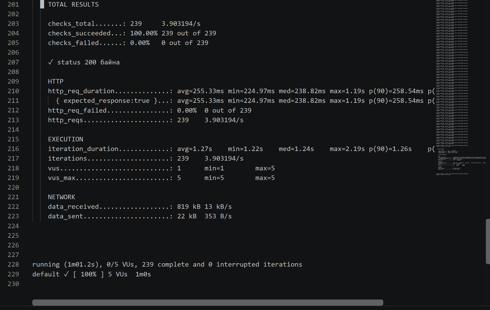
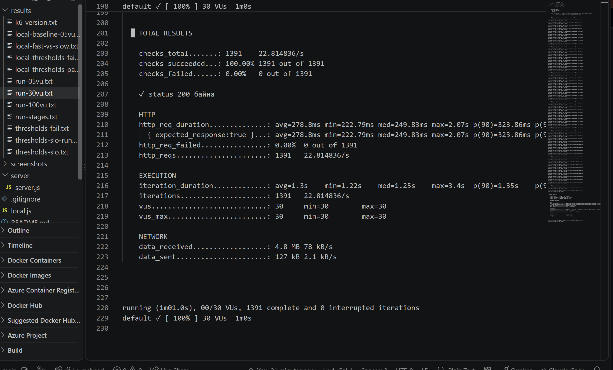
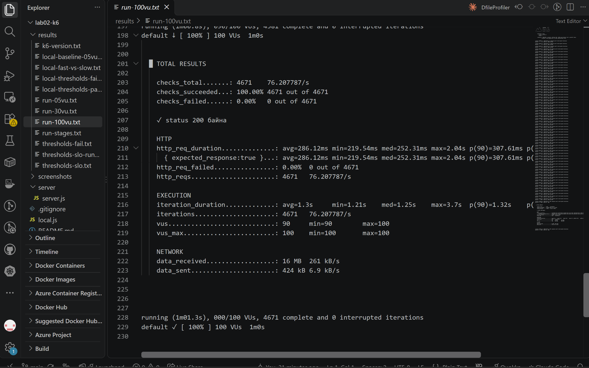
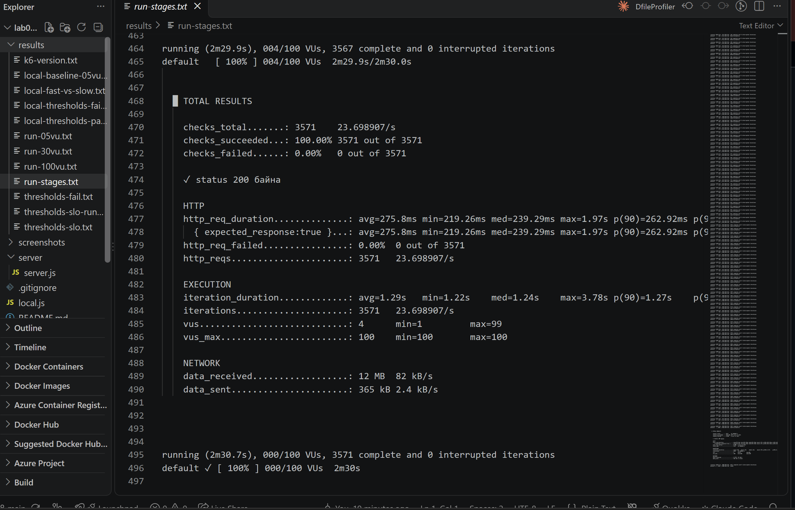
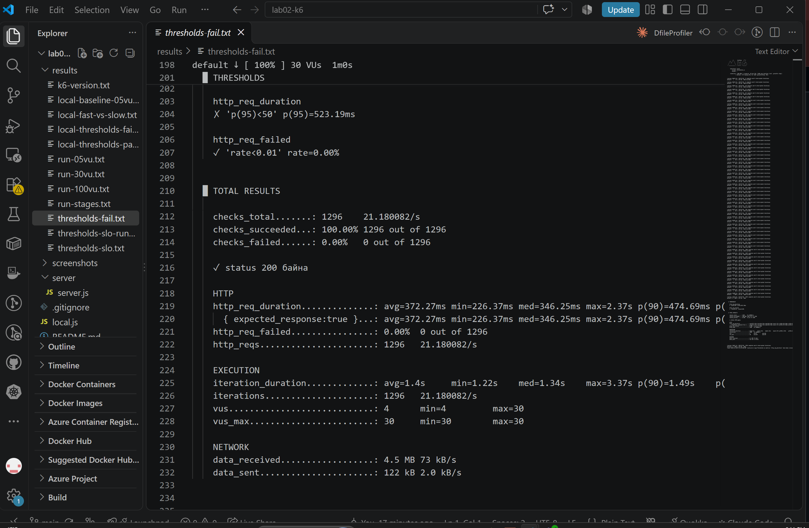

# Lab02 — Гүйцэтгэлийн хэмжүүрийг k6-аар хэмжих

F.CSA313 — Программ хангамжийн чанарын баталгаа ба тест (2026)

**Оюутан:** С.Одгэрэл — **Оюутны код:** B232270099

## k6 хувилбар

```
$ k6 version
k6.exe v2.4.0 (commit/dd9395906d, go1.26.11, windows/amd64)
```

(Windows 11 дээр `winget install GrafanaLabs.k6`-аар суулгасан. Гаралт: [results/k6-version.txt](results/k6-version.txt))

## Бай (target) — ёс зүй

Зөвхөн зөвшөөрөгдсөн бай руу тест хийсэн:

1. **test.k6.io** — энэ хаяг одоо `302 Found` → `https://quickpizza.grafana.com/` руу redirect хийдэг
   (Grafana-ийн албан ёсны дадлагын сайт, test.k6.io-г орлосон). Redirect бүрийг k6 тусдаа request гэж
   тоолж `http_reqs`-ийг хоёр дахин өсгөдөг тул скриптүүд шууд эцсийн хаяг `https://quickpizza.grafana.com` руу хандсан.
2. **Локал сервер** — [server/server.js](server/server.js) (`127.0.0.1:3000`).

## Файлууд

| Файл | Зорилго |
|---|---|
| [script.js](script.js) | Алхам 2 — анхны тест; `--vus`/`--duration`-аар 5/30/100 VU ажиллуулсан |
| [stages.js](stages.js) | Алхам 3 — 5 → 30 → 100 → 0 VU шатлал |
| [thresholds.js](thresholds.js) | Алхам 4 — SLO threshold (`-e P95_MS=`, `-e BASE_URL=`-ээр тохируулна) |
| [server/server.js](server/server.js) | Алхам 5 — локал сервер: `/` (шууд), `/slow` (100 мс хүлээдэг) |
| [local.js](local.js) | Алхам 5 — `/` ба `/slow`-г tag-аар ялгаж хэмжих |
| [results/](results/) | k6-ийн **бүтэн** текст гаралтууд |
| [screenshots/](screenshots/) | Summary-гийн дэлгэцийн зургууд |

## Алхам 2 — Baseline (5 VU, 1 мин)

[results/run-05vu.txt](results/run-05vu.txt):

- `http_req_duration`: avg = **255.33ms**, p(90) = **258.54ms**, p(95) = **268.7ms**
- `http_reqs` (throughput): нийт **239**, **3.903194/s**
- `http_req_failed` (error rate, POFOD-ийн аналог): **0.00%** (0 / 239)

→ **Baseline p95 = 268.7 ms**

## Алхам 3 — Ачааллын түвшний харьцуулалт

Түвшин тус бүрийг `script.js`-ээр **тусад нь** 1 минут ажиллуулсан:

| VU | p90 | p95 | Throughput (req/s) | Нийт req | Error rate | Гаралт |
|---|---|---|---|---|---|---|
| 5 | 258.54 ms | 268.7 ms | 3.90 | 239 | 0.00% | [run-05vu.txt](results/run-05vu.txt) |
| 30 | 323.86 ms | 423.35 ms | 22.81 | 1391 | 0.00% | [run-30vu.txt](results/run-30vu.txt) |
| 100 | 307.61 ms | 362.34 ms | 76.21 | 4671 | 0.00% | [run-100vu.txt](results/run-100vu.txt) |

Stages хувилбар ([results/run-stages.txt](results/run-stages.txt), 2.5 мин, max 100 VU): нийт 3571 req, 23.70 req/s,
p(90) = 262.92ms, p(95) = 488.92ms, error 0.00%. Нэгтгэсэн нэг summary тул түвшин бүрийг салгахгүй, гэхдээ
медиан (239ms) бараг өөрчлөгдөөгүй байхад p95 нь (488.92ms) өндөр гарсан нь **сүүл (tail) latency** ачааллын үед
сунаж байгааг харуулна.

**Туршлага хаана муудаж эхэлсэн бэ?** 5 → 30 VU-д шилжихэд p95 268.7 → 423.35 ms (+58%) болж, миний SLO-ийн
хязгаар (400 ms)-ыг давсан — хэрэглэгчийн туршлага ~30 VU орчим мэдэгдэхүйц муудаж эхэлсэн. 100 VU-д p95 (362.34 ms)
30 VU-гаас бага гарсан нь гадаад сүлжээ болон хуваалцсан демо серверийн хэлбэлзлийг харуулж байна (нэг удаагийн
хэмжилт статистикийн хувьд тогтвортой биш).

## Алхам 4 — Thresholds (SLO)

### SLO-г хэрхэн сонгосон

**SLO: `p(95) < 400ms`, `http_req_failed rate < 0.01`.** Baseline p95 (268.7 ms) × 1.5 ≈ 403 → 400 ms болгон
бөөрөнхийлсөн: бага ачааллын үеийн гүйцэтгэлээс 50%-иас илүү муудвал хэрэглэгч мэдрэх хэмжээний доройтол гэж үзсэн,
мөн гадаад сүлжээний ердийн хэлбэлзэлд зай үлдээсэн. Error rate-ийн хувьд 100 хүсэлт тутамд 1-ээс илүү алдаа
гарахыг хүлээн зөвшөөрөхгүй.

Локал серверийн хувьд мөн адил аргаар: `/slow`-ийн 5 VU baseline p95 = **116.13ms**
([results/local-baseline-05vu.txt](results/local-baseline-05vu.txt)) × 1.5 ≈ 174 → **`p(95) < 175ms`**.

### Үр дүн (30 VU, 1 мин)

| Ажиллуулалт | Бай | Threshold | Хэмжсэн | Үр дүн | Гаралт |
|---|---|---|---|---|---|
| SLO #1 | quickpizza | p95<400, err<1% | p95 = 286.47ms ✓, err = **1.06%** ✗ | **FAIL** | [thresholds-slo.txt](results/thresholds-slo.txt) |
| SLO #2 | quickpizza | p95<400, err<1% | p95 = **557.68ms** ✗, err = 0.00% ✓ | **FAIL** | [thresholds-slo-run2.txt](results/thresholds-slo-run2.txt) |
| Санаатай хатуу | quickpizza | p95<50 | p95 = 523.19ms ✗ | **FAIL** | [thresholds-fail.txt](results/thresholds-fail.txt) |
| SLO (локал) | localhost `/slow` | p95<175, err<1% | p95 = 117.3ms ✓, err = 0.00% ✓ | **PASS** (exit 0) | [local-thresholds-pass.txt](results/local-thresholds-pass.txt) |
| Санаатай хатуу (локал) | localhost `/slow` | p95<50 | p95 = 120.16ms ✗ | **FAIL** (exit 99) | [local-thresholds-fail.txt](results/local-thresholds-fail.txt) |

Ажиглалт:

- SLO #1-д нэг секундэд (17:51:36–37) ~14 хүсэлт `wsarecv: An existing connection was forcibly closed by the remote host`
  алдаагаар унасан — алсын сервер холболтыг тасалсан **availability**-ийн богино доголдол. Latency SLO биелсэн ч
  error-rate SLO зөрчигдсөн нь хоёр хэмжүүрийг хоёуланг нь хянах ёстойг харуулна.
- SLO #2-т яг ижил скрипт, ижил ачаалалтай байхад p95 286 → 558 ms болж хэлбэлзсэн. Гадаад сайт руу SLO-г
  найдвартай шалгах боломжгүй тул (заавар зөвлөсний дагуу) тогтвортой PASS-ыг локал сервер дээр харуулсан.
- Threshold зөрчигдөхөд k6 **exit code 99** буцаадаг (`thresholds on metrics ... have been crossed`) — CI pipeline
  яг энэ exit code-оор quality gate болж build-ийг зогсооно.

## Алхам 5 — Локал сервер: хурдан ба удаан endpoint

[results/local-fast-vs-slow.txt](results/local-fast-vs-slow.txt) (30 VU, 30 сек, sleep-гүй):

| Endpoint | p95 |
|---|---|
| `/` (шууд хариу) | **9.03 ms** |
| `/slow` (100 мс хүлээдэг) | **120.27 ms** |

Нийт 15970 req, **531.00 req/s**, error 0.00%. 100 мс-ийн саатал p95-д бараг шууд (+~111 ms) нэмэгдсэн, мөн VU
бүр `/slow`-г хүлээж байх хугацаанд шинэ хүсэлт илгээж чадахгүй тул throughput-ыг хязгаарласан — latency ба throughput
хоорондоо холбоотойг харуулна (Little's law: зэрэгцээ хэрэглэгч = throughput × хариу өгөх хугацаа).

## Дүгнэлт

1. Ачаалал 5 → 30 → 100 VU болж өсөхөд throughput бараг шугаман өссөн (3.90 → 22.81 → 76.21 req/s), учир нь VU
   бүр `sleep(1)`-тэй тул сервер ханах цэгтээ хүрээгүй.
2. Харин p95 latency 268.7 ms → 423.35 ms болж 30 VU дээр миний 400 ms-ийн SLO-г давсан тул хэрэглэгчийн туршлага ~30 VU
   орчим муудаж эхэлсэн.
3. Энэ нь лекц 2-ын "throughput өсөх нь хэрэглэгч бүрийн хариу өгөх хугацаа сайн гэсэн үг биш" гэсэн зөрчлийг баталсан:
   системийн нийт гүйцэтгэл сайжирч байхад нэгж хэрэглэгчийн хүлээх хугацаа уртассан.
4. Медиан бараг өөрчлөгдөөгүй (~239–252 ms) байхад p95 болон max (1.19 s → ~2 s) өссөн нь дундаж утга биш **percentile**
   (p95/p99)-аар хэмжих ёстой гэдгийг харуулсан.
5. 100 VU-д p95 30 VU-гаас бага гарсан нь гадаад сүлжээ, хуваалцсан серверийн хэлбэлзэл нэг удаагийн хэмжилтийг
   найдваргүй болгодгийг харуулж байна.
6. Ижил SLO тестийг хоёр удаа ажиллуулахад нэг удаа error rate (1.06%), нөгөө удаа p95 (557.68 ms)-аар FAIL болсон.
7. Анхны SLO ажиллуулалтад серверийн холболт тасарснаас үүдсэн алдаа нь **availability** ба **error rate (POFOD)**
   хэмжүүрүүд latency-ээс тусдаа эрсдэл болохыг бодитоор харуулсан.
8. Миний SLO (гадаад: p95 < 400 ms, err < 1%; локал: p95 < 175 ms, err < 1%) baseline × 1.5-аас гарсан бөгөөд локал
   сервер дээр хангагдсан (p95 = 117.3 ms, 0% алдаа), харин гадаад сайт дээр хоёр удаа ч хангагдаагүй.
9. Threshold-ыг санаатайгаар `p(95)<50` болгоход k6 exit code 99-өөр FAIL болсон нь SLO-г кодоор бичиж CI-д quality gate
   болгох боломжийг харуулсан.
10. Локал сервер дээр 100 мс-ийн удаан endpoint p95-ыг 9 ms → 120 ms болгосон нь нэг удаан dependency бүх
    хэрэглэгчийн latency-д шууд нөлөөлдгийг баталсан.

## Дэлгэцийн зургууд

**5 VU, 1 мин**



**30 VU, 1 мин**



**100 VU, 1 мин**



**Stages (5 → 30 → 100 → 0)**



**Thresholds FAIL (`p(95)<50`)**



Threshold PASS гаралтыг [results/local-thresholds-pass.txt](results/local-thresholds-pass.txt)-ээс үзнэ үү.

## Ажиллуулах

```bash
mkdir -p results
k6 run --vus 5   --duration 1m script.js | tee results/run-05vu.txt
k6 run --vus 30  --duration 1m script.js | tee results/run-30vu.txt
k6 run --vus 100 --duration 1m script.js | tee results/run-100vu.txt
k6 run stages.js | tee results/run-stages.txt
k6 run thresholds.js                       # SLO
k6 run -e P95_MS=50 thresholds.js          # санаатай FAIL

node server/server.js                      # тусдаа терминалд
k6 run --vus 5 --duration 1m -e BASE_URL=http://127.0.0.1:3000/slow script.js
k6 run -e BASE_URL=http://127.0.0.1:3000/slow -e P95_MS=175 thresholds.js   # PASS
k6 run -e BASE_URL=http://127.0.0.1:3000/slow -e P95_MS=50  thresholds.js   # FAIL
k6 run local.js
```
